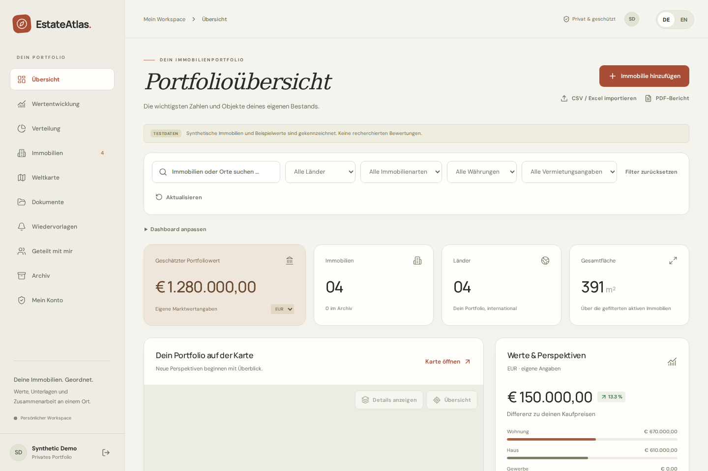

# EstateAtlas

A private workspace for your property portfolio. Keep properties, documents, rental periods and your own valuations together, with a web app and native Android/iOS clients.

[](https://github.com/LuPetro/estate-atlas/actions/workflows/development.yml)
[](https://github.com/LuPetro/estate-atlas/actions/workflows/main.yml)

[Self-hosting](docs/docker.md) · [Development](docs/development.md) · [Contributing](CONTRIBUTING.md) · [Security](SECURITY.md) · [Documentation](docs/README.md)

**Help shape EstateAtlas:** Do you manage several properties with spreadsheets and folders? Share your workflow or installation feedback in [Discussions](https://github.com/LuPetro/estate-atlas/discussions). The [first feedback round](docs/feedback-pilot.md) focuses on importing or adding a first property and returning the following week. Keep addresses, documents and account details private.



_The screenshot uses the app's explicitly labeled synthetic test portfolio, with no user's account, documents or portfolio data. [More interface previews](docs/images/README.md)._

## What you can do

- Organize properties on a map, in cards or in a table; filter, archive and restore them.
- Track your own dated valuations and rental periods. Totals stay separate by currency.
- Keep private photos, PDFs, checklists and reminders with each property; share access with owners, editors and viewers.
- Import up to 50 properties from CSV/Excel with a preview, and generate a PDF portfolio report.
- Record rent, other income, running costs, repairs and loan payments; view monthly totals by property and currency in web and native clients.
- Opt into personal reminder emails with a choice of lead time in your device's timezone, using the installation's configured SMTP delivery.
- Manage your account, sessions, two-factor authentication, exports and account deletion.
- Optionally request source-linked AI research and explicitly choose whether to adopt a result. This requires your own provider configuration and is disabled by default.

EstateAtlas is a portfolio organizer. User-entered values and AI research are not professional appraisals. Email reminders require configured SMTP and a verified recipient account; they are disabled until explicitly selected for a reminder. Push notifications are not implemented. The web app is optionally installable as a PWA; native Expo/React Native apps are separate deliverables.

## Run locally with Docker

Requirements: Git, Bash, `curl`, `tar` with xz support, and Docker with Compose v2 and daemon access. The runtime bootstrap installs the pinned Node version **inside the checkout**. Linux x86_64 is the verified self-hosting platform; other platforms need their own validation.

```bash
git clone https://github.com/LuPetro/estate-atlas.git
cd estate-atlas
./scripts/bootstrap.sh --runtime-only
./scripts/docker up -d --build --wait
```

Open **http://localhost:3000**, choose **Registrieren / Register** and create your own account. There are no default accounts, passwords or signup invitation codes. You can explicitly load synthetic test data after signing in.

This starts Web, API, PostgreSQL, the research worker, backups, maintenance and monitoring. It generates private configuration and secrets under `.local/docker/`. AI and SMTP are disabled, and email verification is optional in this localhost setup. No paid provider account is needed to explore the portfolio.

```bash
./scripts/docker ps
./scripts/docker logs --tail=100 api web
./scripts/docker down
```

`down` keeps your database. `down -v` deletes its volume. Local HTTP is for loopback access only; see [self-hosting](docs/docker.md) for configuration, backups, troubleshooting and public HTTPS prerequisites. On an existing server, follow its environment/migration instructions before starting another stack.

## Web and mobile

The web app runs on Next.js; native Android/iOS clients use Expo and React Native. Both use the same Fastify API, PostgreSQL database, shared schemas and access checks.

Native JavaScript exports are checked in CI. They are not installable APK/IPA files or proof of device compatibility. Signing, device tests, store distribution and the private Dev gateway's native access path remain separate work; see [mobile testing](docs/mobile-testing.md).

## Contribute

Start a feature branch from `dev` and open a pull request targeting `dev`. Release pull requests go from `dev` to `main`.

| Branch | Pipeline and deployment                                                                          |
| ------ | ------------------------------------------------------------------------------------------------ |
| `dev`  | Full checks, then automatic deployment to the private [Dev preview](https://dev.estateatlas.app) |
| `main` | Full checks, then automatic deployment to [estateatlas.app](https://estateatlas.app)             |

The Dev preview needs separate gateway credentials and is not a public demo. A successful build does not by itself publish the production service. The [release checklist](docs/open-source-release.md) tracks publication requirements.

Both pipelines run workflow validation, a full-history secret scan, documentation link checks, types, dependency auditing, real PostgreSQL tests, web builds, desktop/mobile browser tests, Android/iOS JavaScript exports and a fresh-checkout Docker installation check. See [CONTRIBUTING.md](CONTRIBUTING.md) for the project-local toolchain and review process.

## Project structure

```text
apps/web             Next.js web app
apps/mobile          Expo / React Native Android and iOS clients
apps/api             Fastify API, SQL migrations and PostgreSQL tests
packages/shared      Schemas and business rules
packages/api-client  Shared web/native HTTP client
scripts              Local tools, Docker operation and release checks
docs                 Self-hosting, development and maintainer guides
```

## License

[MIT](LICENSE). Bundled fonts, map data and dependencies retain their own terms; see [third-party notices](THIRD_PARTY_NOTICES.md).
