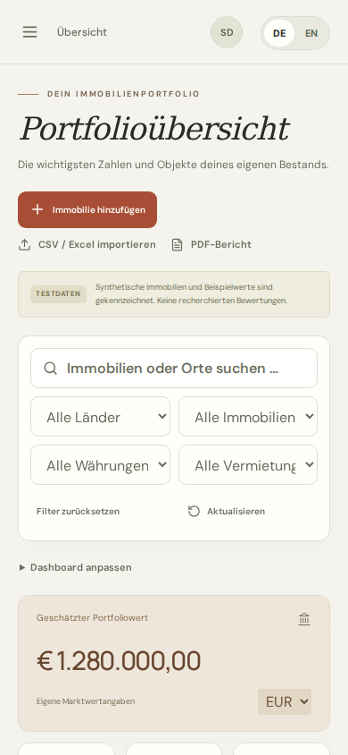
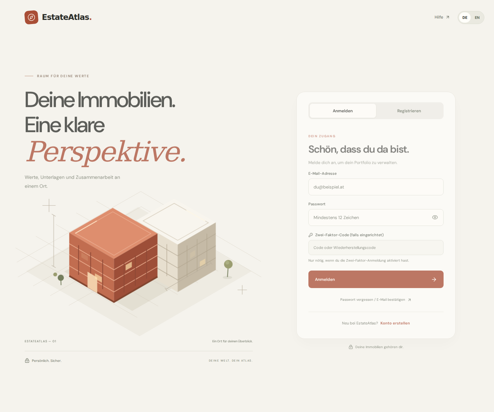

# Interface previews

Generated by `scripts/check-self-hosting.mjs --screenshots` against a fresh, isolated Docker installation. The portfolio and account are synthetic fixtures; no user data is used. External browser requests are blocked while capturing previews. These images show web desktop/mobile viewports, not native device builds.

## Portfolio, desktop

## Portfolio, mobile web

## Sign in

Regenerate using the [developer guide](../development.md), then inspect the output before committing it.
